# Buku Petunjuk Penggunaan Aplikasi (User Manual)
## Sistem Informasi Display Jadwal & Monitoring Penggunaan Laboratorium Komputer Terpadu
### Fakultas Ilmu Komputer — UPN "Veteran" Jakarta

---

## Tentang Panduan Ini
*~ ii ~*

Buku Petunjuk Penggunaan Aplikasi (*User Manual*) ini disusun sebagai dokumen panduan operasional resmi bagi seluruh pemangku kepentingan (*stakeholder*) dalam mengoperasikan **Sistem Informasi Jadwal & Monitoring Penggunaan Laboratorium Komputer Terpadu**.

Petunjuk penggunaan ini dibuat agar pengguna (**Dosen / Lecturer, Laboran, dan Administrator**) dapat memahami seluruh alur kerja sistem, fitur pemantauan *real-time* pada TV Kiosk, mekanisme pengajuan peminjaman mandiri, deteksi bentrok jadwal otomatis, hingga proses persetujuan dan rekapitulasi data laboratorium secara efektif dan efisien sesuai dengan prosedur standar yang telah ditetapkan.

> [!NOTE]
> **Tujuan Dokumentasi**: Buku panduan ini mengadopsi pendekatan visual interaktif langkah demi langkah (*step-by-step walkthrough*) yang dilengkapi tangkapan layar antarmuka nyata dan tabel spesifikasi elemen formulir untuk memudahkan pengoperasian sehari-hari.

---

## Daftar Isi
*~ iii ~*

- [TENTANG PANDUAN INI](#tentang-panduan-ini)
- [DAFTAR ISI](#daftar-isi)
- [1. PENDAHULUAN](#1-pendahuluan)
  - [1.1 Tujuan Pembuatan Dokumen](#11-tujuan-pembuatan-dokumen)
  - [1.2 Deskripsi Umum Sistem](#12-deskripsi-umum-sistem)
  - [1.3 Pembagian Peran Pengguna (Role & Hak Akses)](#13-pembagian-peran-pengguna-role--hak-akses)
  - [1.4 Deskripsi Dokumen](#14-deskripsi-dokumen)
- [2. KEBUTUHAN SUMBER DAYA](#2-kebutuhan-sumber-daya)
  - [2.1 Perangkat Lunak Pendukung (Software Requirement)](#21-perangkat-lunak-pendukung-software-requirement)
  - [2.2 Perangkat Keras Pendukung (Hardware Requirement)](#22-perangkat-keras-pendukung-hardware-requirement)
  - [2.3 Jaringan Komunikasi Data (Network Requirement)](#23-jaringan-komunikasi-data-network-requirement)
  - [2.4 Kualifikasi Sumber Daya Manusia (SDM)](#24-kualifikasi-sumber-daya-manusia-sdm)
- [3. MEMULAI APLIKASI & AUTENTIKASI](#3-memulai-aplikasi--autentikasi)
  - [3.1 Mengakses URL Sistem (Display Kiosk TV vs Portal Web)](#31-mengakses-url-sistem)
  - [3.2 Halaman Login & Prosedur Autentikasi Pengguna](#32-halaman-login--prosedur-autentikasi)
  - [3.3 Penanganan Gagal Login & Logout Sistem](#33-penanganan-gagal-login--logout-sistem)
- [4. MODUL DISPLAY TV KIOSK (MONITORING REAL-TIME 1080P)](#4-modul-display-tv-kiosk-monitoring-real-time-1080p)
  - [4.1 Tampilan Antarmuka Layar Penuh Display Kiosk TV](#41-tampilan-antarmuka-layar-penuh-display-kiosk)
  - [4.2 Matriks 8 Laboratorium & Indikator Status Ruangan](#42-matriks-8-laboratorium--indikator-status-ruangan)
  - [4.3 Jam Digital, Countdown Sesi, dan Running Text (Ticker)](#43-jam-digital-countdown-sesi-dan-running-text-ticker)
  - [4.4 Quick QR Reservasi Mandiri & Modal Inspeksi Fasilitas](#44-quick-qr-reservasi--modal-inspeksi-fasilitas)
- [5. MODUL PENJADWALAN & RESERVASI LAB (ROLE DOSEN / LECTURER)](#5-modul-penjadwalan--reservasi-dosenlecturer)
  - [5.1 Melihat Matriks Kalender Jadwal Multi-Lab Mingguan](#51-melihat-matriks-kalender-jadwal-multi-lab-mingguan)
  - [5.2 Mengisi Formulir Pengajuan Peminjaman Lab Mandiri](#52-mengisi-formulir-pengajuan-peminjaman-lab-mandiri)
  - [5.3 Validasi & Pencegahan Bentrok Jadwal Otomatis (Conflict Detection)](#53-validasi--pencegahan-bentrok-jadwal-otomatis)
  - [5.4 Pelaporan Tiket Kendala Fasilitas (Issue Ticketing)](#54-pelaporan-tiket-kendala-fasilitas-issue-ticketing)
- [6. MODUL DASHBOARD & VERIFIKASI PEMINJAMAN (ROLE LABORAN)](#6-modul-dashboard--verifikasi-peminjaman-role-laboran)
  - [6.1 Dashboard Monitoring & Statistik Operasional Laboran](#61-dashboard-monitoring--statistik-operasional-laboran)
  - [6.2 Alur Peninjauan & Persetujuan Permohonan Ruang](#62-alur-peninjauan--persetujuan-permohonan-ruang)
  - [6.3 Prosedur Check-In dan Check-Out Penggunaan Ruangan](#63-prosedur-check-in-dan-check-out-penggunaan-ruangan)
  - [6.4 Manajemen Master Ruang Laboratorium & Jam Operasional](#64-manajemen-data-ruang-lab--jam-operasional)
- [7. MODUL ADMINISTRATOR SISTEM (ROLE ADMIN)](#7-modul-administrator-sistem-role-admin)
  - [7.1 Manajemen Data Pengguna & Hak Akses (RBAC)](#71-manajemen-data-pengguna--hak-akses-rbac)
  - [7.2 Siaran Pengumuman Terjadwal (Broadcast Announcement)](#72-siaran-pengumuman-terjadwal-broadcast-announcement)
  - [7.3 Rekapitulasi & Ekspor Laporan Aktivitas Lab (Excel & PDF)](#73-rekapitulasi--ekspor-laporan-aktivitas-lab-excel--pdf)
- [8. INFORMASI PERUBAHAN DOKUMEN (REVISION HISTORY)](#8-informasi-perubahan-dokumen)

---

# 1. Pendahuluan

### 1.1 Tujuan Pembuatan Dokumen
Dokumen petunjuk penggunaan aplikasi (*User Manual*) ini disusun dengan tujuan memberikan panduan teknis dan operasional yang komprehensif bagi seluruh pengguna dalam memanfaatkan **Sistem Informasi Display Jadwal & Monitoring Penggunaan Laboratorium Komputer Terpadu** secara maksimal.

Dengan tersedianya buku panduan ini, diharapkan integrasi sistem informasi digital laboratorium dapat berjalan lancar, meminimalkan potensi kesalahan operasional (*human-error*), mencegah terjadinya bentrok jadwal peminjaman ruangan antar kelas/jurusan, serta mempercepat proses birokrasi verifikasi laboratorium.

### 1.2 Deskripsi Umum Sistem
Sistem Informasi Display Jadwal & Monitoring Penggunaan Laboratorium Komputer Terpadu adalah aplikasi modern berbasis web yang mengintegrasikan pemantauan layar publik TV Kiosk Full HD 1080p, layanan reservasi ruang mandiri bagi Dosen (Lecturer), dashboard verifikasi cepat laboran, serta pelaporan otomatis aktivitas lab.

Sistem mengadopsi arsitektur Single Page Application (Vue 3 + Vite) di sisi frontend dan NestJS Modular Engine di sisi backend yang terhubung langsung ke database PostgreSQL 16. Seluruh pembaruan status jadwal disinkronkan secara instan (*real-time zero-reload*) dalam waktu di bawah 500 milidetik melalui teknologi WebSocket (Socket.io).

### 1.3 Pembagian Peran Pengguna (Role & Hak Akses)
Sistem menerapkan mekanisme *Role-Based Access Control* (RBAC) dengan pemisahan 5 hak akses utama:
1. **Layar Kiosk TV (Public)**: Tampilan informasi layar penuh tanpa autentikasi (*unauthenticated*) untuk layar TV koridor lab yang menampilkan status langsung 8 lab, jadwal aktif, countdown waktu, dan QR code reservasi.
2. **Dosen (Lecturer)**: Pengguna akademik terautentikasi yang berwenang mengajukan peminjaman ruang laboratorium mandiri, memeriksa kalender jadwal perkuliahan, mengunggah dokumen surat permohonan resmi (PDF), memantau status persetujuan reservasi, serta melaporkan tiket kendala fasilitas lab.
4. **Laboran (Lab Officer)**: Pengguna operasional berwenang melakukan verifikasi cepat (*Quick Approve / Reject*) permohonan ruang, mengelola sesi Check-In / Check-Out, serta mengatur inventaris alat lab.
5. **Administrator (Admin)**: Pengelola tertinggi dengan kewenangan mengelola akun pengguna, hak akses peran (RBAC), menyiarkan pengumuman (*broadcast ticker*), dan mencetak laporan audit.

### 1.4 Deskripsi Dokumen
Buku petunjuk penggunaan ini terbagi ke dalam beberapa bab terstruktur:
- **Bab 1 (Pendahuluan)**: Menjelaskan latar belakang, tujuan pembuatan panduan, deskripsi sistem, dan hak akses peran.
- **Bab 2 (Kebutuhan Sumber Daya)**: Menjelaskan kebutuhan spesifikasi perangkat keras, perangkat lunak, jaringan LAN, dan SDM.
- **Bab 3 (Memulai Aplikasi & Autentikasi)**: Menjelaskan langkah awal membuka aplikasi, prosedur login pengguna, dan keamanan sesi.
- **Bab 4 (Modul Display TV Kiosk)**: Menjelaskan fitur pemantauan 8 lab, indikator status, countdown, jam, dan inspeksi alat.
- **Bab 5 (Modul Penjadwalan & Reservasi)**: Menjelaskan tata cara melihat jadwal, form pengajuan booking lab, dan deteksi bentrok.
- **Bab 6 (Modul Verifikasi Laboran)**: Menjelaskan dasbor statistik, alur verifikasi permohonan ruang, dan check-in/out ruangan.
- **Bab 7 (Modul Administrator)**: Menjelaskan manajemen akun, siaran teks berjalan, serta ekspor laporan spreadsheet/PDF.
- **Bab 8 (Informasi Perubahan Dokumen)**: Mencatat riwayat revisi dan penyempurnaan dokumen panduan pengguna.

---

# 2. Kebutuhan Sumber Daya

### 2.1 Perangkat Lunak Pendukung (Software Requirement)
Untuk dapat mengakses dan mengoperasikan antarmuka aplikasi, dibutuhkan perangkat lunak dengan spesifikasi berikut:
- **Sistem Operasi Klien**: Windows 10/11, macOS Monterey+, Ubuntu Desktop 20.04+, atau ChromeOS.
- **Peramban Web (Browser)**: Google Chrome (versi 100+ disarankan), Microsoft Edge, Mozilla Firefox, atau Safari dengan fitur WebSocket aktif.
- **Lingkungan Server Host**: Ubuntu Server 22.04 / 24.04 LTS atau Docker Desktop pada Windows Server.
- **Engine Kontainer**: Docker Engine 24.0+ dan Docker Compose v2.20+ (sudah membundel PostgreSQL 16, Node.js 22 LTS, dan Nginx Alpine).

### 2.2 Perangkat Keras Pendukung (Hardware Requirement)

#### A. Perangkat Server Aplikasi & Database (Host)
| No | Komponen Hardware | Spesifikasi Minimum | Spesifikasi Rekomendasi |
| :---: | :--- | :--- | :--- |
| **1** | Prosesor (CPU) | Intel Core i3 / 2 Cores 2.0 GHz | Intel Core i5 / AMD Ryzen 5 (4+ Cores) |
| **2** | Memori Utama (RAM) | 2 GB DDR4 (1 GB free) | 4 GB - 8 GB DDR4 |
| **3** | Media Penyimpanan | SSD 32 GB (Sisa 10 GB) | SSD NVMe 128 GB+ |
| **4** | Kartu Jaringan (NIC) | Fast Ethernet 100 Mbps | Gigabit Ethernet 1000 Mbps |

#### B. Perangkat Klien Display TV Kiosk (Layar Koridor Lab)
| No | Komponen Hardware | Spesifikasi Minimum | Spesifikasi Rekomendasi |
| :---: | :--- | :--- | :--- |
| **1** | Layar Monitor / TV | Smart TV / LED Monitor 32" Full HD | Smart TV / Monitor 43" - 55" 1080p Full HD |
| **2** | Player / Mini PC Kiosk | Android TV Box / Raspberry Pi 4 (2GB) | Intel NUC / Mini PC Stick (Windows/Linux) |
| **3** | Resolusi Tampilan | 1366 x 768 piksel | 1920 x 1080 piksel (16:9 Landscape) |
| **4** | Kabel Koneksi | HDMI 1.4 / DisplayPort | HDMI 2.0 High Speed |

### 2.3 Jaringan Komunikasi Data (Network Requirement)
Sistem dapat beroperasi optimal di jaringan lokal kampus FIK UPNVJ (Local Area Network / Intranet) maupun jaringan internet publik:
- **Kecepatan Jaringan**: Minimal 512 Kbps per klien (karena sistem sangat hemat kuota dengan transmisi diff WebSocket JSON berukuran < 2 KB).
- **Media Transmisi**: Terhubung via kabel LAN UTP Cat5e/Cat6 atau Wi-Fi 802.11n/ac dengan latency di bawah 100 ms.
- **Port Komunikasi**: Port 80 (HTTP Web/Kiosk) dan Port 3000 (REST API / WebSocket Engine).

### 2.4 Kualifikasi Sumber Daya Manusia (SDM)
- **Pengguna Dosen (Lecturer)**: Memahami pengoperasian komputer, dapat menggunakan peramban web modern, dan terbiasa mengelola jadwal kegiatan akademik serta formulir reservasi online.
- **Laboran**: Memahami jadwal operasional laboratorium, prosedur keselamatan ruang praktikum, serta alur peminjaman alat inventaris.
- **Administrator IT**: Memahami manajemen akun pengguna, dasar konfigurasi jaringan lokal (IP address), dan pemeliharaan cadangan data (backup database).

---

# 3. Memulai Aplikasi & Autentikasi

### 3.1 Mengakses URL Sistem
Untuk mulai menggunakan aplikasi, pastikan komputer klien atau TV Kiosk telah terhubung ke jaringan kampus UPNVJ / internet:
1. **Buka Web Browser**: Buka peramban web (Google Chrome / Microsoft Edge disarankan).
2. **Ketik Alamat URL**: Masukkan alamat URL sistem pada address bar browser:
   - Portal Aplikasi / Login: `http://<IP_SERVER>/login` (atau `http://localhost/login`)
   - Layar Publik TV Kiosk: `http://<IP_SERVER>/` (atau `http://localhost/`)
3. **Muat Halaman**: Tekan tombol **Enter** pada keyboard. Browser akan memuat antarmuka sistem.

### 3.2 Halaman Login & Prosedur Autentikasi
Pengguna yang memerlukan akses khusus (Dosen, Laboran, dan Admin) wajib melakukan autentikasi melalui form login:

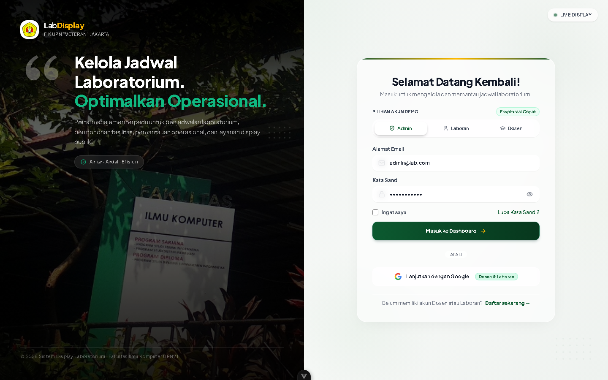
*Gambar 1. Halaman Login Aplikasi & Autentikasi Pengguna Sah*

**Langkah-langkah melakukan login aplikasi:**
1. **Masukkan Email**: Ketikkan alamat email resmi yang telah terdaftar pada kolom "Email" (contoh: `lecturer@lab.com`, `laboran@lab.com`, atau `admin@lab.com`).
2. **Masukkan Password**: Ketikkan kata sandi akun pada kolom "Kata Sandi". Anda dapat menekan ikon mata untuk melihat karakter kata sandi.
3. **Klik Tombol Masuk**: Klik tombol hijau bertuliskan `[ Masuk ]`.
4. **Pengalihan Dasbor**: Sistem memvalidasi kredensial pengguna via JWT (*JSON Web Token*). Jika berhasil, pengguna secara otomatis diarahkan ke dasbor peran masing-masing.

| No | Elemen Formulir | Tipe Input | Keterangan & Aturan Validasi |
| :---: | :--- | :--- | :--- |
| **1** | Email | Input Text (Email) | Wajib diisi dengan format email valid yang terdaftar aktif pada database. |
| **2** | Kata Sandi (Password) | Input Password | Wajib diisi. Sandi diverifikasi menggunakan enkripsi hash bcrypt. |
| **3** | Tombol `[ Masuk ]` | Button (Submit) | Memicu request POST /api/auth/login dan menerbitkan token akses JWT. |
| **4** | Tautan "Kembali ke Display" | Hyperlink Navigasi | Mengarahkan kembali ke layar utama monitoring TV Kiosk. |

### 3.3 Penanganan Gagal Login & Logout Sistem
> [!WARNING]
> **Pencegahan Akses Ilegal**: Jika email atau password tidak sesuai, sistem akan menampilkan pesan peringatan merah: *"Email atau kata sandi tidak valid"*. Sistem secara otomatis menolak akses dan membatasi percobaan login berulang untuk mencegah *brute-force attack*.

**Prosedur Keluar dari Aplikasi (Logout):**
1. **Buka Menu Profil**: Pada bilah navigasi atas (*top bar*) atau menu samping dasbor, klik foto profil atau nama pengguna Anda.
2. **Pilih Tombol Logout**: Pilih opsi `[ Keluar / Logout ]`.
3. **Sesi Dihapus**: Sistem akan menghapus token sesi JWT dari penyimpanan browser dan mengarahkan kembali ke halaman login dengan aman.

---

# 4. Modul Display TV Kiosk (Monitoring 1080p)

### 4.1 Tampilan Antarmuka Layar Penuh Display Kiosk
Modul Display TV Kiosk dirancang khusus untuk ditayangkan pada monitor TV koridor laboratorium secara 24/7 tanpa memerlukan interaksi keyboard atau mouse. Halaman ini dioptimalkan untuk resolusi Full HD (1920x1080 piksel) dengan kontras visual tinggi agar mudah dibaca dari kejauhan.

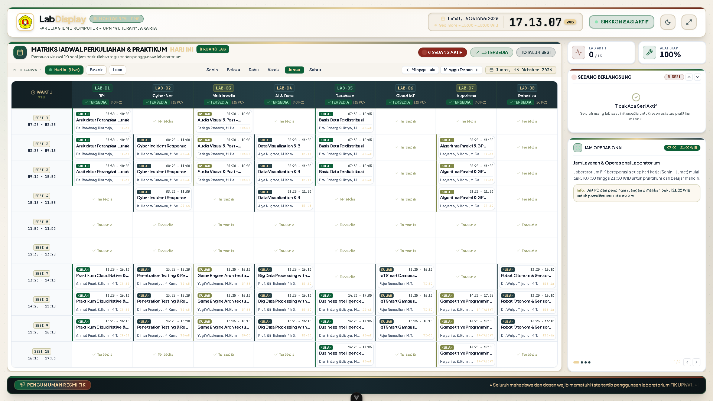
*Gambar 2. Tampilan Utama Display TV Kiosk 1080p Full HD (Monitoring 8 Lab)*

### 4.2 Matriks 8 Laboratorium & Indikator Status Ruangan
Pada bagian tengah antarmuka, sistem menampilkan matriks 8 laboratorium komputer secara simultan (Lab Komputer 1 hingga Lab Komputer 8). Setiap kartu laboratorium dilengkapi lencana status (*badge*) dinamis:
- **Badge Hijau `[ TERSEDIA ]`**: Laboratorium sedang kosong dan siap digunakan atau dipinjam untuk sesi berikutnya.
- **Badge Kuning / Oranye `[ BERLANGSUNG ]`**: Sedang ada sesi praktikum/perkuliahan yang aktif berlangsung di dalam lab. Dilengkapi judul mata kuliah/praktikum, nama Dosen pengampu, dan kelompok mahasiswa.
- **Badge Merah `[ PERAWATAN / CLOSED ]`**: Laboratorium sedang dalam masa pemeliharaan perangkat keras atau ditutup sementara oleh laboran.

### 4.3 Jam Digital, Countdown Sesi, dan Running Text (Ticker)
- **Jam Digital Presisi**: Menampilkan hari, tanggal, dan waktu detik secara sinkron sesuai zona Waktu Indonesia Barat (WIB / UTC+7).
- **Hitung Mundur Sesi (Countdown)**: Pada lab yang sedang aktif digunakan, sistem menghitung mundur sisa durasi praktikum secara real-time (contoh: *"Sisa Waktu: 42 Menit"*).
- **Teks Berjalan (Running Text)**: Bilah informasi di bagian bawah layar menampilkan pengumuman penting fakultas/program studi FIK UPNVJ yang bergerak horizontal secara mulus (*smooth ticker*).

### 4.4 Quick QR Reservasi & Modal Inspeksi Fasilitas
Dosen atau sivitas akademika yang berada di depan layar TV dapat langsung memindai QR Code di sudut layar menggunakan kamera smartphone untuk membuka formulir reservasi lab instan.

*Gambar 3. Jendela Modal Inspeksi Fasilitas & Peralatan Laboratorium*

Jika layar TV Kiosk berupa monitor sentuh (*Touchscreen*), pengunjung dapat menyentuh salah satu kartu lab untuk membuka jendela popup detail yang menyajikan spesifikasi perangkat keras (jumlah PC aktif, proyektor, AC, dan kapasitas kursi).

---

# 5. Modul Penjadwalan & Reservasi (Dosen/Lecturer)

### 5.1 Melihat Matriks Kalender Jadwal Multi-Lab Mingguan
Menu "Jadwal Penggunaan" menyajikan visualisasi matriks jadwal seluruh 8 laboratorium selama satu minggu penuh (Senin hingga Sabtu). Setiap jadwal ditampilkan dalam blok warna interaktif sesuai tingkat urgensi sesi praktikum.

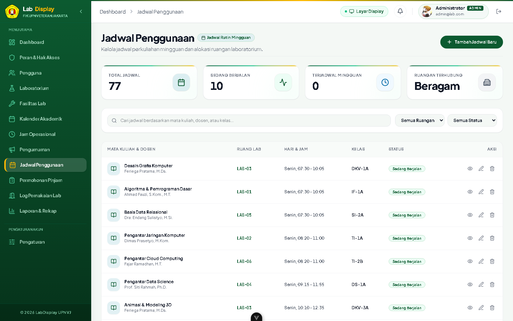
*Gambar 4. Kalender Jadwal Multi-Lab Mingguan*

**Cara menggunakan filter pada kalender jadwal:**
1. **Filter Laboratorium**: Gunakan dropdown "Pilih Laboratorium" untuk membatasi tampilan hanya pada lab tertentu, atau pilih "Semua Laboratorium".
2. **Navigasi Pekan**: Gunakan pemilih "Minggu / Tanggal" untuk melihat jadwal di masa mendatang atau riwayat minggu lalu.
3. **Inspeksi Slot**: Arahkan kursor mouse ke blok jadwal untuk melihat informasi detil: mata kuliah/praktikum, nama dosen pengampu, kelas/kelompok, dan rentang jam perkuliahan.

### 5.2 Mengisi Formulir Pengajuan Peminjaman Lab Mandiri
Dosen (Lecturer) dapat mengajukan permohonan peminjaman ruang lab di luar jadwal rutin perkuliahan secara mandiri melalui tombol `[ + Ajukan Peminjaman ]`:

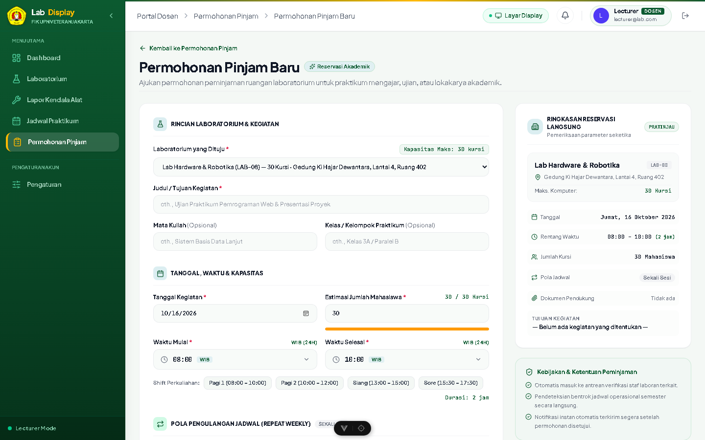
*Gambar 5. Formulir Pengajuan Reservasi / Peminjaman Lab Mandiri*

| No | Kolom Formulir | Tipe Input | Petunjuk Pengisian & Ketentuan |
| :---: | :--- | :--- | :--- |
| **1** | Laboratorium | Dropdown Select | Pilih salah satu dari 8 laboratorium yang ingin dipinjam. |
| **2** | Tanggal Peminjaman | Date Picker | Pilih tanggal pelaksanaan kegiatan (minimal hari H atau setelahnya). |
| **3** | Jam Mulai & Jam Selesai | Time Picker | Tentukan rentang jam penggunaan sesuai jam operasional lab. |
| **4** | Tujuan Kegiatan | Text Area | Jelaskan keperluan peminjaman (contoh: "Praktikum Tambahan UKK RPL"). |
| **5** | Jumlah Peserta | Number Input | Masukkan estimasi jumlah mahasiswa/peserta (tidak boleh melebihi kapasitas lab). |
| **6** | Surat Permohonan (PDF) | File Upload | Wajib melampirkan berkas permohonan bertanda tangan dalam format PDF (maks. 5MB). |

### 5.3 Validasi & Pencegahan Bentrok Jadwal Otomatis
Sistem dilengkapi algoritma *Conflict Detection Engine* yang bekerja di sisi browser dan server. Jika peminjam memilih waktu dan lab yang telah dipesan orang lain, sistem secara instan menampilkan peringatan merah dan memblokir pengajuan:

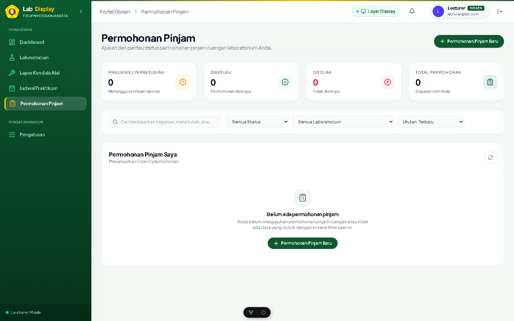
*Gambar 6. Notifikasi Deteksi Bentrok Jadwal Otomatis (Conflict Prevention)*

> [!CAUTION]
> **Keamanan Validasi Bentrok**: Sistem tidak akan mengizinkan pengajuan tersimpan ke database jika terjadi tumpang tindih waktu (*overlap*) walau hanya 1 menit. Pengguna wajib mengganti slot jam atau memilih ruang lab lain yang masih kosong.

### 5.4 Pelaporan Tiket Kendala Fasilitas (Issue Ticketing)
Apabila Dosen menemukan kendala kerusakan sarana praktikum (seperti mouse/PC bermasalah, kabel LAN putus, proyektor tidak tampil, atau AC tidak dingin), laporan dapat dikirimkan melalui menu "Tiket Kendala":

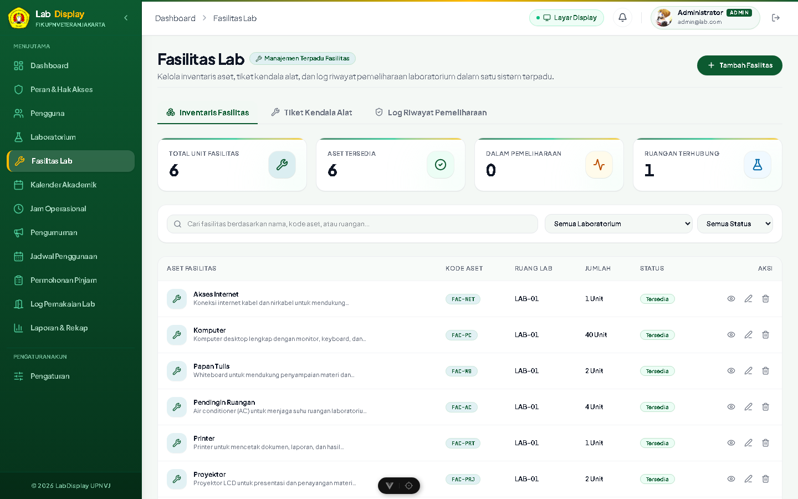
*Gambar 7. Formulir Pelaporan Kendala & Kerusakan Fasilitas (Issue Ticket)*

Laboran akan menerima notifikasi tiket dan memperbarui status penanganan menjadi "Dalam Pengecekan" atau "Selesai Diperbaiki".

---

# 6. Modul Verifikasi & Operasional (Laboran)

### 6.1 Dashboard Monitoring & Statistik Operasional Laboran
Setelah login dengan akun Laboran, pengguna disambut oleh halaman Dashboard Monitoring yang menyajikan ringkasan statistik terkini operasional seluruh lab:

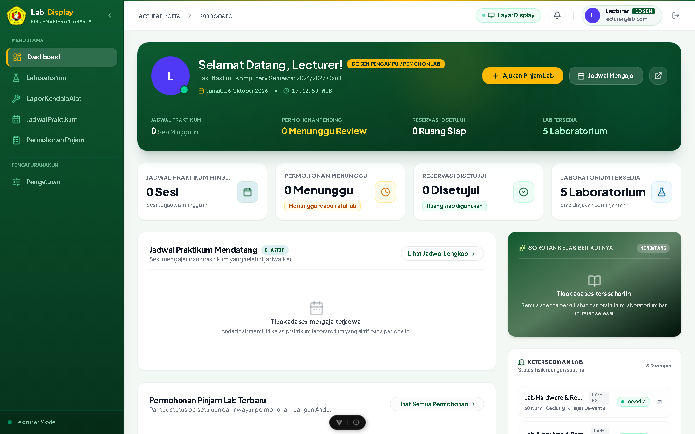
*Gambar 8. Dashboard Utama Monitoring & Statistik Laboran*

Informasi yang disajikan meliputi jumlah permohonan menunggu persetujuan (*Pending Requests*), total laboratorium aktif digunakan, jumlah tiket kendala sarana yang belum tertangani, dan kalender kegiatan hari ini.

### 6.2 Alur Peninjauan & Persetujuan Permohonan Ruang
Laboran memegang kewenangan penuh untuk menyetujui (*Approve*) atau menolak (*Reject*) setiap reservasi ruang pada menu "Permohonan Peminjaman":

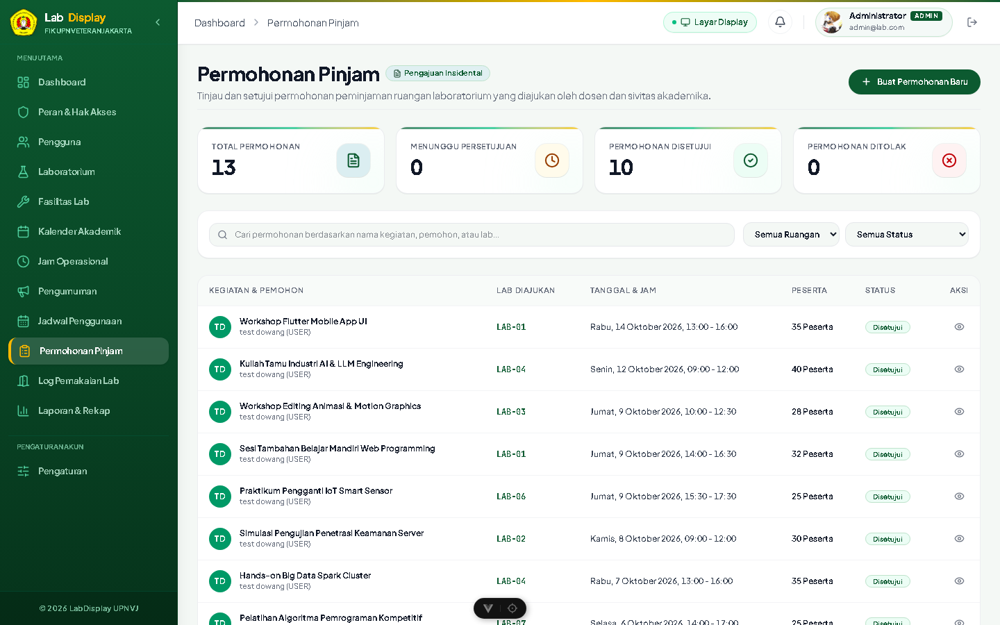
*Gambar 9. Tabel Verifikasi & Peninjauan Permohonan Peminjaman Ruang*

**Prosedur peninjauan peminjaman oleh Laboran:**
1. **Tinjau Daftar Permohonan**: Periksa daftar pengajuan berstatus `[ PENDING ]` pada tabel permohonan.
2. **Verifikasi Berkas PDF**: Klik tombol `[ Detail / Berkas ]` untuk memeriksa surat permohonan resmi berformat PDF yang dilampirkan peminjam.
3. **Persetujuan (Approval)**: Jika permohonan valid dan lab siap digunakan, klik tombol hijau `[ Setujui ]`. Sistem otomatis mengubah status menjadi APPROVED dan menerbitkan jadwal resmi.
4. **Penolakan (Rejection)**: Jika lab berhalangan atau alasan tidak memenuhi syarat, klik tombol merah `[ Tolak ]` dan berikan alasan penolakan secara jelas.

### 6.3 Prosedur Check-In dan Check-Out Penggunaan Ruangan
Untuk menjamin akurasi data pemanfaatan ruang, Laboran wajib melakukan pencatatan saat Dosen mulai dan selesai menggunakan laboratorium:

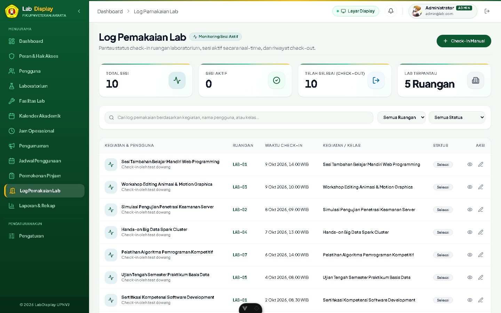
*Gambar 10. Antarmuka Manajemen Sesi Check-In & Tracking Status Ruangan*

1. **Sesi Check-In**: Saat Dosen penanggung jawab tiba di lab, klik tombol `[ Check-In ]`. Status lab pada layar TV Kiosk seketika berubah menjadi `[ BERLANGSUNG ]`.
2. **Sesi Check-Out**: Saat sesi praktikum selesai dan lab ditinggalkan dalam keadaan rapi, klik tombol `[ Check-Out ]`. Status lab pada TV Kiosk seketika kembali menjadi `[ TERSEDIA ]`.

### 6.4 Manajemen Data Ruang Lab & Jam Operasional
Laboran juga dapat mengelola daftar perangkat inventaris per laboratorium, mengatur batas kapasitas kursi, serta mengonfigurasi jam buka-tutup lab sesuai kalender akademik semester UPN "Veteran" Jakarta.

---

# 7. Modul Administrator Sistem (Admin)

### 7.1 Manajemen Data Pengguna & Hak Akses (RBAC)
Administrator memiliki kendali penuh atas keamanan dan akun pengguna pada menu "Manajemen Pengguna":

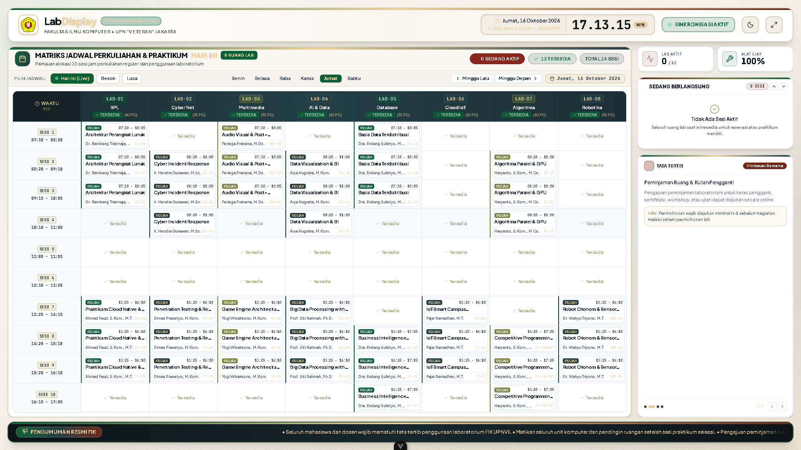
*Gambar 11. Panel Manajemen Pengguna & Hak Akses RBAC (Role-Based Access Control)*

1. **Registrasi Pengguna Baru**: Untuk mendaftarkan akun baru, klik tombol `[ + Tambah Pengguna ]`, isi nama lengkap, email institusi UPNVJ (@upnvj.ac.id), password, dan pilih perannya (Admin, Laboran, Dosen).
2. **Penguncian Akun Nonaktif**: Untuk menonaktifkan akun staf yang telah mutasi/lulus, ubah status akun dari ACTIVE menjadi INACTIVE.
3. **Reset Kredensial**: Admin dapat melakukan reset password jika pengguna mengalami kendala lupa kata sandi.

### 7.2 Siaran Pengumuman Terjadwal (Broadcast Announcement)
Melalui menu "Pengumuman", Administrator dapat menerbitkan pesan broadcast yang langsung muncul sebagai running text (*ticker*) di layar TV Kiosk 1080p koridor laboratorium. Fitur ini sangat berguna untuk menyiarkan informasi pelaksanaan Uji Kompetensi Keahlian (UKK), asesmen ANBK, maupun jadwal perawatan berkala server lab.

### 7.3 Rekapitulasi & Ekspor Laporan Aktivitas Lab (Excel & PDF)
Untuk keperluan pertanggungjawaban kepada Pimpinan Fakultas, Dekanat FIK, dan Koordinator Laboratorium Komputer UPNVJ, sistem menyediakan modul pelaporan statistik terpadu:

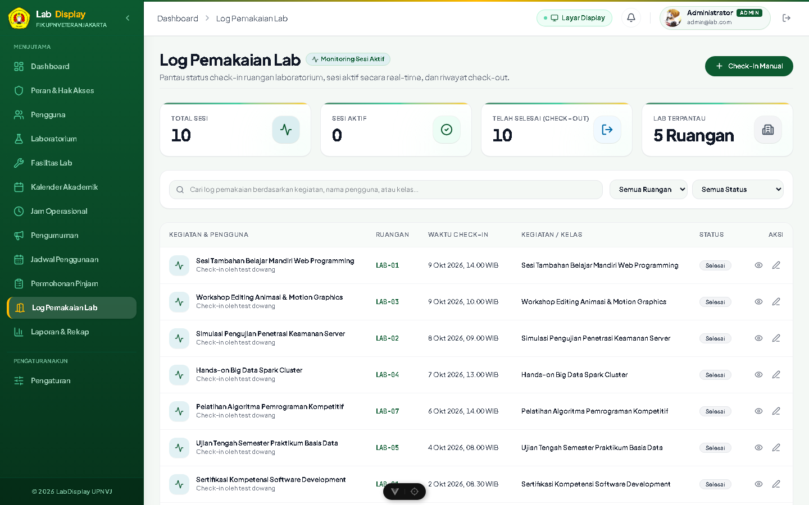
*Gambar 12. Halaman Rekapitulasi & Ekspor Laporan Riwayat Penggunaan Lab*

**Cara mengekspor laporan penggunaan lab:**
1. **Tentukan Periode Audit**: Pilih rentang tanggal audit (Tanggal Mulai s/d Tanggal Selesai).
2. **Pilih Filter Laboratorium**: Pilih filter laboratorium atau pilih "Semua Laboratorium".
3. **Ekspor Spreadsheet**: Klik tombol hijau `[ Ekspor Excel (.xlsx) ]` untuk mengunduh rekapitulasi data mentah dan diagram grafik lembar kerja spreadsheet.
4. **Ekspor Dokumen PDF**: Klik tombol merah `[ Ekspor PDF (.pdf) ]` untuk mengunduh dokumen laporan formal siap cetak lengkap dengan kop surat dan kolom tanda tangan.

---

# 8. Informasi Perubahan Dokumen

Tabel riwayat revisi dan penyempurnaan dokumen Buku Petunjuk Penggunaan Aplikasi (*User Manual*):

| Tanggal | Deskripsi Perubahan | Versi | Disusun Oleh |
| :---: | :--- | :---: | :---: |
| **14 Oktober 2026** | Penyusunan awal draf dokumen User Manual berbasis sistem uji UAT | **1.0** | Kayra Sahadewa |
| **20 Oktober 2026** | Penambahan panduan detail modul Display TV Kiosk 1080p, modal inspeksi fasilitas, dan alur Quick QR | **1.1** | Kayra Sahadewa |
| **21 Oktober 2026** | Penyelarasan dokumentasi diagram UML (Use Case & Activity Diagram) serta integrasi bukti uji UAT TC-CL-01 s/d TC-CL-12 | **1.2** | Kayra Sahadewa |
| **02 November 2026** | Penyusunan edisi resmi User Manual operasional lengkap: arsitektur kontainer Docker, PostgreSQL, multi-role RBAC, dan pelaporan ekspor Excel/PDF | **2.0** | Kayra Sahadewa |

> [!TIP]
> **Pusat Bantuan & Dukungan Teknis**: Apabila pengguna menemui kendala teknis operasional yang tidak tercakup dalam buku panduan ini, silakan menghubungi Tim Pengelola Laboratorium Komputer Fakultas Ilmu Komputer UPN "Veteran" Jakarta melalui email: `lab-fik@upnvj.ac.id`.
