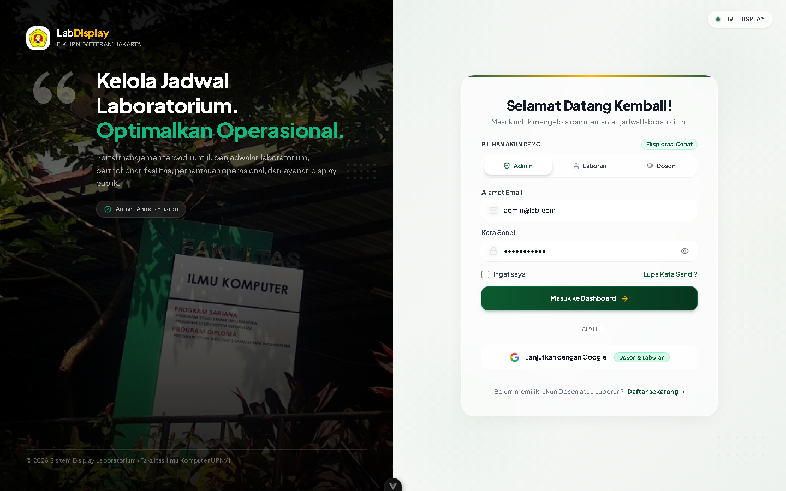

# 🧪 Bukti Pengujian: TC-CL-01
## Login Akun Sah (Admin / Laboran) dengan Autentikasi JWT

* **ID Kasus Uji**: `TC-CL-01`
* **Kebutuhan Terkait**: `FR-01, NFR-05`
* **Modul / Komponen**: `backend/src/modules/auth & frontend/src/views/auth`
* **Tanggal Pelaksanaan**: 14 Oktober 2026
* **Status Pengujian**: ✅ **PASS (BERHASIL / LOLOS)**
* **Klasifikasi**: *User Acceptance Testing (UAT) — Client Deliverable*

---

### 1. 📌 Skenario & Kondisi Awal
* **Prekondisi Basis Data**:  
  Akun pengguna berstatus ACTIVE telah terdaftar pada database PostgreSQL dengan password terenkripsi bcrypt.

---

### 2. 📝 Langkah-Langkah Pengujian (Test Steps)
1. Buka antarmuka login pada URL /login.
2. Masukkan alamat email valid (laboran@upnvj.ac.id) dan password yang benar.
3. Klik tombol "Masuk".

---

### 3. 🎯 Hasil Pengujian (Test Results)
* **Hasil yang Diharapkan (Expected Result)**:  
  Server merespons kode HTTP 200 OK, menghasilkan accessToken JWT berisi klaim peran, dan mengarahkan pengguna ke dasbor peran terkait.
* **Hasil Aktual Sistem (Actual Result)**:  
  Sistem berhasil mengautentikasi pengguna, menerbitkan JWT token yang disimpan pada state auth, dan pengguna diarahkan ke dasbor laboran.
* **Catatan Pengujian**:  
  Token JWT terverifikasi memiliki masa berlaku 24 jam dengan algoritma HS256.

---


### 4. 📸 Bukti Tangkapan Layar Nyata Aplikasi (Application Screenshot)


### 5. 💻 Bukti Eksekusi Teknis (Technical Execution Snippet)

```json
// Response API: POST /api/auth/login
{
  "statusCode": 200,
  "message": "Login successful",
  "data": {
    "accessToken": "eyJhbGciOiJIUzI1NiIsInR5cCI6IkpXVCJ9...",
    "user": {
      "id": "usr_9912a7bf-811c-4b92",
      "full_name": "Staf Laboran Komputer FIK",
      "email": "laboran@upnvj.ac.id",
      "role": { "code": "LABORAN", "name": "Staf Laboran" },
      "status": "ACTIVE"
    }
  }
}
```

---

[⬅️ Kembali ke Indeks Bukti Pengujian (evidence)](../README.md)
