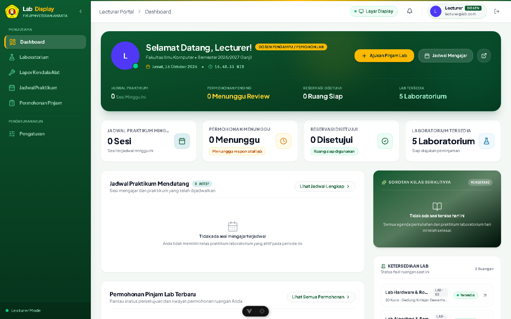

# 🧪 Bukti Pengujian: TC-CL-02
## Pencegahan Akses Ilegal Antar Role (RBAC Security Guard)

* **ID Kasus Uji**: `TC-CL-02`
* **Kebutuhan Terkait**: `FR-01, NFR-05`
* **Modul / Komponen**: `backend/src/modules/auth/guards/roles.guard.ts`
* **Tanggal Pelaksanaan**: 14 Oktober 2026
* **Status Pengujian**: ✅ **PASS (BERHASIL / LOLOS)**
* **Klasifikasi**: *User Acceptance Testing (UAT) — Client Deliverable*

---

### 1. 📌 Skenario & Kondisi Awal
* **Prekondisi Basis Data**:  
  Pengguna telah berhasil login sebagai akun dengan peran Dosen / Mahasiswa.

---

### 2. 📝 Langkah-Langkah Pengujian (Test Steps)
1. Dalam keadaan login sebagai Dosen, akses langsung URL khusus administrator (/admin/users).
2. Kirim request REST API ke endpoint administratif: POST /api/users dengan Authorization Bearer token milik Dosen.

---

### 3. 🎯 Hasil Pengujian (Test Results)
* **Hasil yang Diharapkan (Expected Result)**:  
  Sistem menolak request dengan status HTTP 403 Forbidden dan menampilkan pesan penolakan hak akses.
* **Hasil Aktual Sistem (Actual Result)**:  
  RolesGuard NestJS memblokir request dan mengembalikan response error 403 Forbidden.
* **Catatan Pengujian**:  
  Prinsip least-privilege RBAC berjalan dengan aman mencegah eskalasi hak akses ilegal.

---


### 4. 📸 Bukti Tangkapan Layar Nyata Aplikasi (Application Screenshot)


### 5. 💻 Bukti Eksekusi Teknis (Technical Execution Snippet)

```json
// Response API: POST /api/users (dengan token Dosen)
{
  "statusCode": 403,
  "error": "Forbidden",
  "message": "Forbidden resource: User role 'DOSEN' does not have permission to access this endpoint"
}
```

---

[⬅️ Kembali ke Indeks Bukti Pengujian (evidence)](../README.md)
