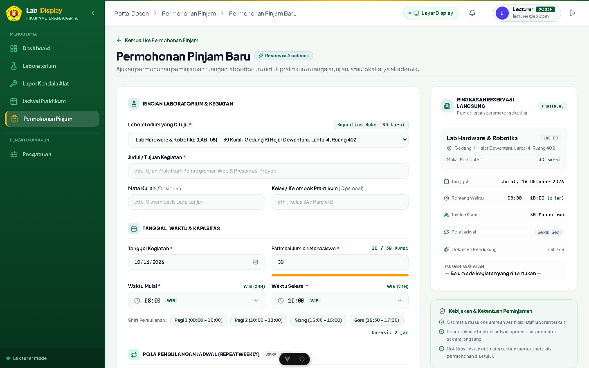

# 🧪 Bukti Pengujian: TC-CL-04
## Pengajuan Peminjaman Lab dengan Berkas Lampiran Sah (PDF)

* **ID Kasus Uji**: `TC-CL-04`
* **Kebutuhan Terkait**: `FR-04`
* **Modul / Komponen**: `backend/src/modules/room-request & frontend/src/views/room-requests`
* **Tanggal Pelaksanaan**: 14 Oktober 2026
* **Status Pengujian**: ✅ **PASS (BERHASIL / LOLOS)**
* **Klasifikasi**: *User Acceptance Testing (UAT) — Client Deliverable*

---

### 1. 📌 Skenario & Kondisi Awal
* **Prekondisi Basis Data**:  
  Dosen / Pemohon telah terautentikasi pada portal permohonan ruang.

---

### 2. 📝 Langkah-Langkah Pengujian (Test Steps)
1. Buka form "Pengajuan Peminjaman Laboratorium".
2. Lengkapi formulir: nama kegiatan, tanggal peminjaman, jam mulai/selesai, jumlah peserta.
3. Lampirkan berkas permohonan resmi dalam format PDF (ukuran 2.4 MB).
4. Klik "Kirim Pengajuan".

---

### 3. 🎯 Hasil Pengujian (Test Results)
* **Hasil yang Diharapkan (Expected Result)**:  
  Permohonan tersimpan di basis data dengan status PENDING dan berkas lampiran tersimpan aman pada storage.
* **Hasil Aktual Sistem (Actual Result)**:  
  Data permohonan berhasil terbit dengan ID unik dan berkas PDF tersimpan.
* **Catatan Pengujian**:  
  MIME-type application/pdf terverifikasi aman.

---


### 4. 📸 Bukti Tangkapan Layar Nyata Aplikasi (Application Screenshot)


### 5. 💻 Bukti Eksekusi Teknis (Technical Execution Snippet)

```json
// Response API: POST /api/room-requests
{
  "statusCode": 201,
  "message": "Room request created successfully",
  "data": {
    "id": "req_881a2f1c-9921-4d1a",
    "activity_name": "Workshop Artificial Intelligence",
    "status": "PENDING",
    "attachment_url": "/uploads/room-requests/proposal-ai-workshop.pdf",
    "file_size_bytes": 2516582
  }
}
```

---

[⬅️ Kembali ke Indeks Bukti Pengujian (evidence)](../README.md)
