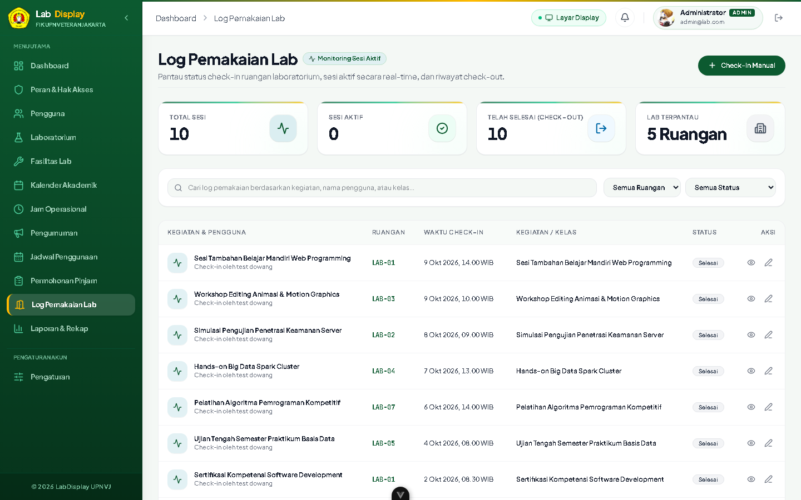

# 🧪 Bukti Pengujian: TC-CL-07
## Pencatatan Sesi Check-In & Tracking Status Ruangan Real-Time

* **ID Kasus Uji**: `TC-CL-07`
* **Kebutuhan Terkait**: `FR-06, FR-09`
* **Modul / Komponen**: `backend/src/modules/room-usage/room-usage.service.ts`
* **Tanggal Pelaksanaan**: 14 Oktober 2026
* **Status Pengujian**: ✅ **PASS (BERHASIL / LOLOS)**
* **Klasifikasi**: *User Acceptance Testing (UAT) — Client Deliverable*

---

### 1. 📌 Skenario & Kondisi Awal
* **Prekondisi Basis Data**:  
  Jadwal praktikum aktif terdaftar untuk jam berjalan.

---

### 2. 📝 Langkah-Langkah Pengujian (Test Steps)
1. Laboran mengklik tombol "Mulai Sesi (Check-In)".
2. Amati perubahan status ruangan pada dasbor internal dan layar display TV.

---

### 3. 🎯 Hasil Pengujian (Test Results)
* **Hasil yang Diharapkan (Expected Result)**:  
  Status ruangan seketika berubah menjadi IN_USE, timestamp check-in riil tercatat, dan indikator TV Display berubah menjadi merah berdenyut.
* **Hasil Aktual Sistem (Actual Result)**:  
  Sesi RoomUsage terbuat dengan status IN_USE, dan WebSocket broadcast terkirim ke layar display.
* **Catatan Pengujian**:  
  Sinkronisasi instan tanpa memerlukan refresh halaman.

---


### 4. 📸 Bukti Tangkapan Layar Nyata Aplikasi (Application Screenshot)


### 5. 💻 Bukti Eksekusi Teknis (Technical Execution Snippet)

```json
// Response API: POST /api/room-usage/check-in
{
  "statusCode": 201,
  "message": "Laboratory session checked in successfully",
  "data": {
    "usage_id": "usg_10294bce-391a-4f81",
    "laboratory_id": "lab_01",
    "status": "IN_USE",
    "check_in_time": "2026-10-14T08:00:12.451Z"
  }
}
```

---

[⬅️ Kembali ke Indeks Bukti Pengujian (evidence)](../README.md)
