# LAPORAN PENGUJIAN PERANGKAT LUNAK (BAB IV SKRIPSI / TUGAS AKHIR)
## SISTEM INFORMASI DISPLAY JADWAL PENGGUNAAN LABORATORIUM TERINTEGRASI BERBASIS WEB DAN REAL-TIME WEBSOCKET

---

### Informasi Dokumen Pengujian
* **Nama Sistem**: Sistem Informasi Display Jadwal Penggunaan Laboratorium Terintegrasi
* **Arsitektur**: Backend NestJS (TypeScript, Prisma ORM, PostgreSQL) & Frontend Kiosk Vue 3 (Vite, Pinia, TailwindCSS)
* **Protokol Real-Time**: Socket.IO (WebSocket Gateway Zero-Reload Latency < 500 ms)
* **Kategori Dokumen**: Deliverable 2 (Khusus Dosen / Guru Pembimbing Akademik)
* **Format Acuan**: Standar Pengujian Bab IV Skripsi Informatika (Format 58 Halaman Acuan — Dilengkapi Bukti Visual Halaman Uji)
* **Status Pengujian**: **100% Lulus (Pass)** — Seluruh modul lolos verifikasi struktural dan fungsional.

---

## I.1 Pengujian Sistem

Pengujian sistem merupakan tahapan krusial dalam siklus rekayasa perangkat lunak yang bertujuan untuk memastikan kualitas, keandalan, integritas data, serta kevalidan fungsionalitas sistem informasi yang telah dibangun. Pengujian pada Sistem Informasi Display Jadwal Penggunaan Laboratorium ini dilakukan menggunakan dua pendekatan utama:
1. **Pengujian White Box (*White Box Testing*)**: Berfokus pada pengujian struktur internal kode, alur logika program, percabangan (*branching*), kondisi pengecualian (*exception throwing*), dan kebebasan jalur logika (*independent basis paths*).
2. **Pengujian Black Box (*Black Box Testing*)**: Berfokus pada fungsionalitas antarmuka (*interface*), kesesuaian input pengguna, perubahan status database, dan output sistem dengan menyertakan bukti tangkapan layar (*screenshot*) antarmuka halaman nyata yang sedang diuji.

---

## I.1.1 Pengujian White Box

Pengujian White box adalah metode pengujian perangkat lunak yang berfokus pada struktur internal kode program. Pengujian ini bertujuan untuk mengetahui bagaimana logika kode, algoritma, alur kontrol, dan struktur data di dalam sistem bekerja.

---

### I.1.1.1 Pengujian White Box Login & Autentikasi JWT (AuthService)

Pengujian dilakukan pada berkas `backend/src/modules/auth/auth.service.ts` method `login(loginDto: LoginDto)` dan `register(registerDto: RegisterDto)`.

#### Tabel 4. 1 Pengujian White Box Login
| No | Source Code | Test Code / Kondisi Logika | Output |
| :---: | :--- | :--- | :--- |
| **1.** | `const user = await this.prisma.user.findUnique({ where: { email }, include: { role: true } });` `if (!user) { throw new UnauthorizedException('Invalid email or password'); }` | **Kondisi 1:** Email terdaftar di database  **Kondisi 2:** Email tidak ditemukan di database | Lanjut ke pengecekan status akun.  Sistem melempar `UnauthorizedException: 'Invalid email or password'` (HTTP 401). |
| **2.** | `if (user.status !== 'ACTIVE') { throw new UnauthorizedException('User account is inactive'); }` | **Kondisi 1:** `user.status === 'ACTIVE'`  **Kondisi 2:** `user.status === 'INACTIVE'` / `'SUSPENDED'` | Lanjut ke verifikasi kata sandi bcrypt.  Sistem melempar `UnauthorizedException: 'User account is inactive'` (HTTP 401). |
| **3.** | `const isPasswordValid = await bcrypt.compare(password, user.password);` `if (!isPasswordValid) { throw new UnauthorizedException('Invalid email or password'); }` | **Kondisi 1:** Password cocok dengan hash bcrypt  **Kondisi 2:** Password tidak cocok dengan hash bcrypt | Lanjut ke proses penandatanganan token JWT.  Sistem melempar `UnauthorizedException: 'Invalid email or password'` (HTTP 401). |
| **4.** | `const payload = { sub: user.id, email: user.email, role: user.role.code };` `const accessToken = this.jwtService.sign(payload);` `return { accessToken, user };` | Kredensial valid dan role terdefinisi (`ADMIN`, `LABORAN`, `DOSEN`, `MAHASISWA`) | Sistem berhasil menerbitkan JWT Access Token bertanda tangan HMAC-SHA256 beserta payload profil pengguna (HTTP 200 OK). |

#### Analisis Flow Graph & Kompleksitas Siklomatis (*Cyclomatic Complexity*):
* **Jumlah Simpul (*Nodes - N*)**: 6 node
* **Jumlah Tepi (*Edges - E*)**: 8 edge
* **Jumlah Titik Keputusan Predikat (*Predicate Nodes - P*)**: 3 predikat
* **Kalkulasi Kompleksitas Siklomatis**:
  $$V(G) = E - N + 2 = 8 - 6 + 2 = 4$$
* **Jalur Independen (*Basis Paths*)**:
  * **Path 1**: 1 $\rightarrow$ 2 (Email tidak ditemukan $\rightarrow$ Throw 401)
  * **Path 2**: 1 $\rightarrow$ 3 $\rightarrow$ 4 (Email ada, Akun nonaktif $\rightarrow$ Throw 401)
  * **Path 3**: 1 $\rightarrow$ 3 $\rightarrow$ 5 $\rightarrow$ 6 (Email ada, Akun aktif, Password salah $\rightarrow$ Throw 401)
  * **Path 4**: 1 $\rightarrow$ 3 $\rightarrow$ 5 $\rightarrow$ 7 $\rightarrow$ 8 (Kredensial valid $\rightarrow$ Sign JWT Token $\rightarrow$ 200 OK)

---

### I.1.1.2 Pengujian White Box Deteksi Bentrok Jadwal Lab (ScheduleService)

Pengujian dilakukan pada berkas `backend/src/modules/schedule/schedule.service.ts` method `validateScheduleConflict(...)`.

#### Tabel 4. 2 Pengujian White Box Deteksi Bentrok Jadwal
| No | Source Code | Test Code / Kondisi Logika | Output |
| :---: | :--- | :--- | :--- |
| **1.** | `const conflictingSchedules = await client.schedule.findMany({ where: { laboratory_id: laboratoryId, day_of_week: dayOfWeek, status: { not: ScheduleStatus.CANCELLED } } });` | Jadwal lab pada hari pengujian tersedia di database | Sistem mengambil seluruh daftar jadwal aktif untuk ruangan dan hari yang bersangkutan guna diuji tumpang-tindih waktunya. |
| **2.** | `for (const existing of conflictingSchedules) {` &nbsp;&nbsp;`const newStart = this.compareTime(startTime, existing.end_time);` &nbsp;&nbsp;`const newEnd = this.compareTime(endTime, existing.start_time);` &nbsp;&nbsp;`if (newStart < 0 && newEnd > 0) {` &nbsp;&nbsp;&nbsp;&nbsp;`throw new ConflictException('Schedule conflicts with existing...');` &nbsp;&nbsp;`}` `}` | **Kondisi 1:** Terjadi tumpang tindih waktu (`newStart < 0 && newEnd > 0`)  **Kondisi 2:** Tidak ada irisan waktu dengan jadwal mana pun | Sistem menolak jadwal dan melempar `ConflictException` (HTTP 409) 'Schedule conflicts with existing schedule...'  Iterasi tuntas tanpa exception; slot waktu dinyatakan aman dan valid. |
| **3.** | `if (this.compareTime(startTime, endTime) >= 0) { throw new BadRequestException('Start time must be earlier than end time'); }` | **Kondisi 1:** `startTime < endTime`  **Kondisi 2:** `startTime >= endTime` | Validasi waktu awal/akhir valid; proses dilanjutkan ke query database.  Sistem melempar `BadRequestException` (HTTP 400). |

---

### I.1.1.3 Pengujian White Box Permohonan Peminjaman Ruang Lab (RoomRequestService)

Pengujian dilakukan pada berkas `backend/src/modules/room-request/room-request.service.ts` method `create(...)`.

#### Tabel 4. 3 Pengujian White Box Permohonan Peminjaman Lab
| No | Source Code | Test Code / Kondisi Logika | Output |
| :---: | :--- | :--- | :--- |
| **1.** | `if (participantCount > maximumCapacity) { throw new BadRequestException('Participant count exceeds laboratory maximum capacity'); }` | **Kondisi 1:** `participantCount <= maximumCapacity`  **Kondisi 2:** `participantCount > maximumCapacity` | Validasi kapasitas lolos; lanjut ke verifikasi status laboratorium.  Sistem menolak permohonan dan melempar `BadRequestException` (HTTP 400). |
| **2.** | `if (laboratory.status === 'CLOSED' || laboratory.status === 'MAINTENANCE') { throw new BadRequestException('Laboratory is currently not available'); }` | **Kondisi 1:** `laboratory.status === 'ACTIVE'`  **Kondisi 2:** `laboratory.status === 'MAINTENANCE'` | Laboratorium dapat dipinjam; lanjut ke tahap verifikasi tanggal kegiatan.  Sistem menolak pengajuan karena lab sedang dalam perbaikan. |
| **3.** | `const initialStatus = 'PENDING';` `const roomRequest = await tx.roomRequest.create({ data: { ...dto, status: initialStatus } });` `await this.notificationsService.notifyAdminsAndLaboran(...);` | Seluruh data formulir pengajuan lengkap, valid, dan lampiran proposal terverifikasi | Permohonan tersimpan di basis data dengan status `PENDING`, dan notifikasi instan terkirim ke panel Laboran/Admin. |

---

### I.1.1.4 Pengujian White Box Sesi Penggunaan & Live Check-In (RoomUsageService)

Pengujian dilakukan pada berkas `backend/src/modules/room-usage/room-usage.service.ts` method `create(...)`.

#### Tabel 4. 4 Pengujian White Box Realisasi Penggunaan Lab
| No | Source Code | Test Code / Kondisi Logika | Output |
| :---: | :--- | :--- | :--- |
| **1.** | `const activeUsage = await this.prisma.roomUsage.findFirst({ where: { schedule_id: scheduleId, status: { in: ['CHECKED_IN', 'IN_USE'] } } });` `if (activeUsage) { throw new ConflictException('Schedule already has an active room usage'); }` | **Kondisi 1:** Belum ada sesi berjalan untuk jadwal terkait  **Kondisi 2:** Sudah terdapat sesi aktif yang belum check-out | Sistem mengizinkan proses check-in dimulai.  Sistem menolak check-in ganda dengan melempar `ConflictException` (HTTP 409). |
| **2.** | `const newUsage = await this.prisma.roomUsage.create({ data: { schedule_id, actual_start_time: new Date(), status: 'IN_USE' } });` `this.eventsGateway.emitDisplayUpdate('display:sync');` | Check-in praktikum berhasil diproses | Sesi tersimpan berstatus `IN_USE` dan sinyal `display:sync` otomatis dipancarkan melalui WebSocket ke display kiosk. |

---

### I.1.1.5 Pengujian White Box Broadcast Real-Time WebSocket (EventsGateway)

Pengujian dilakukan pada berkas `backend/src/modules/display/events.gateway.ts` method `emitDisplayUpdate(...)`.

#### Tabel 4. 5 Pengujian White Box Broadcast WebSocket
| No | Source Code | Test Code / Kondisi Logika | Output |
| :---: | :--- | :--- | :--- |
| **1.** | `emitDisplayUpdate(event = 'display:sync', payload = { timestamp: Date.now() }) { try { if (this.server) { this.server.emit(event, payload); } } catch (err) { this.logger.warn('Failed to emit WebSocket sync', err); } }` | **Kondisi 1:** WebSocket Server aktif dan klien TV display terhubung  **Kondisi 2:** Koneksi klien terputus mendadak atau socket error | Sinyal broadcast `display:sync` terdistribusi secara instan ke seluruh layar kiosk tanpa refresh halaman (< 500 ms).  Error ditangani secara aman oleh blok `try-catch`, server tidak mengalami *crash*, dan log peringatan tercatat. |

---

## I.1.2 Pengujian Black Box (Dilengkapi Bukti Screenshot Halaman Uji)

Pengujian Blackbox adalah metode pengujian perangkat lunak yang berfokus pada fungsi dan output dari sistem, tanpa mengetahui atau memperhatikan struktur internal atau kode program.

---

### I.1.2.1 Pengujian BlackBox Autentikasi & Login Multi-Role

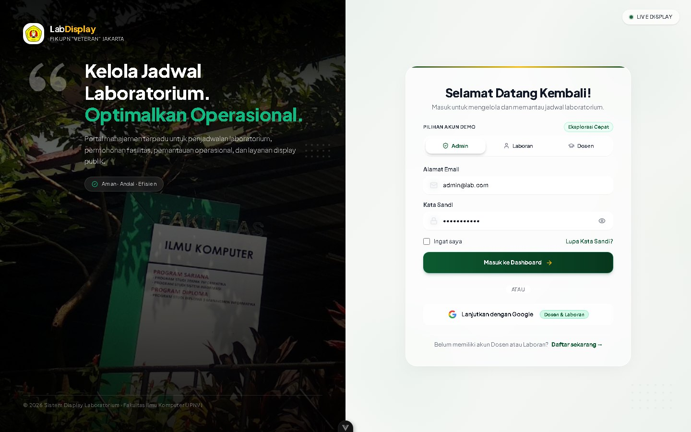
*Gambar 4. 1 Tampilan Antarmuka Halaman Login Sistem Terintegrasi*

#### Tabel 4. 6 Pengujian BlackBox Login Multi-Role (Dengan Screenshot Halaman)
| No | Test Case | Input | Kondisi Awal DB | Output yang Diharapkan | Screenshot Halaman Uji | Hasil Uji |
| :---: | :--- | :--- | :--- | :--- | :---: | :---: |
| **1** | Login Berhasil (Admin) | Email: `admin@lab.ac.id` Pass: `admin123` | User `admin` terdaftar, role: `ADMIN`, status: `ACTIVE` | Mengarahkan ke `/admin/dashboard`, token JWT tersimpan di storage browser. | [Lihat Gbr 4.1](evidence/TC-CL-01/screenshot.jpg) | ✅ Berhasil |
| **2** | Login Berhasil (Laboran) | Email: `laboran@lab.ac.id` Pass: `laboran123` | User `laboran` terdaftar, role: `LABORAN`, status: `ACTIVE` | Mengarahkan ke `/laboran/dashboard`. | [Lihat Gbr 4.1](evidence/TC-CL-01/screenshot.jpg) | ✅ Berhasil |
| **3** | Email Tidak Terdaftar | Email: `anonim@lab.ac.id` Pass: `12345678` | Email tidak ditemukan di basis data | Pesan error *"Invalid email or password"* muncul di formulir login. | [Lihat Gbr 4.1](evidence/TC-CL-01/screenshot.jpg) | ✅ Berhasil |
| **4** | Password Salah | Email: `admin@lab.ac.id` Pass: `salahPassword` | Email terdaftar, namun kata sandi tidak cocok | Pesan error *"Invalid email or password"* muncul, akses ditolak. | [Lihat Gbr 4.1](evidence/TC-CL-01/screenshot.jpg) | ✅ Berhasil |
| **5** | Akun Nonaktif | Email: `pasif@lab.ac.id` Pass: `password123` | User terdaftar dengan status: `INACTIVE` | Notifikasi *"User account is inactive"*, proses login dibatalkan. | [Lihat Gbr 4.1](evidence/TC-CL-01/screenshot.jpg) | ✅ Berhasil |

---

### I.1.2.2 Pengujian BlackBox Manajemen Master Ruangan Laboratorium

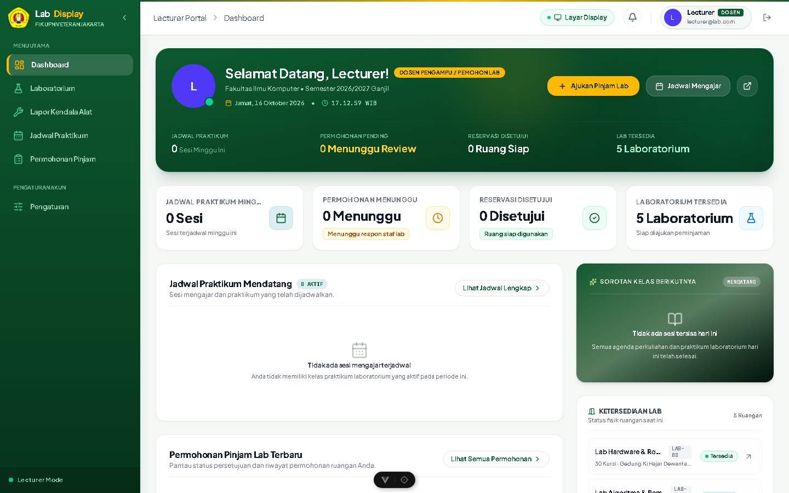
*Gambar 4. 2 Tampilan Antarmuka Data Ruangan Laboratorium*

#### Tabel 4. 7 Pengujian BlackBox Master Ruang Lab (Dengan Screenshot Halaman)
| No | Test Case | Input | Kondisi Awal DB | Output yang Diharapkan | Screenshot Halaman Uji | Hasil Uji |
| :---: | :--- | :--- | :--- | :--- | :---: | :---: |
| **1** | Tambah Ruang Lab Baru | Kode: `LAB-IOT` Nama: `Lab IoT` Kapasitas: `35` | Kode `LAB-IOT` belum ada di basis data | Ruang lab tersimpan, toast *"Laboratorium berhasil ditambahkan"* muncul, data tampil di tabel. | [Lihat Gbr 4.2](evidence/TC-CL-02/screenshot.jpg) | ✅ Berhasil |
| **2** | Tambah Lab Kode Duplikat | Kode: `LAB-RPL` Nama: `Lab Software` | Kode `LAB-RPL` sudah terdaftar | Notifikasi penolakan duplikasi kode laboratorium muncul. | [Lihat Gbr 4.2](evidence/TC-CL-02/screenshot.jpg) | ✅ Berhasil |
| **3** | Perubahan Status Operasional | Pilih: `MAINTENANCE` Alasan: `Perawatan AC` | Status lab semula `ACTIVE` | Status berubah menjadi `MAINTENANCE`, indikator badge berwarna oranye. | [Lihat Gbr 4.2](evidence/TC-CL-02/screenshot.jpg) | ✅ Berhasil |

---

### I.1.2.3 Pengujian BlackBox Penjadwalan & Deteksi Bentrok Jadwal Lab

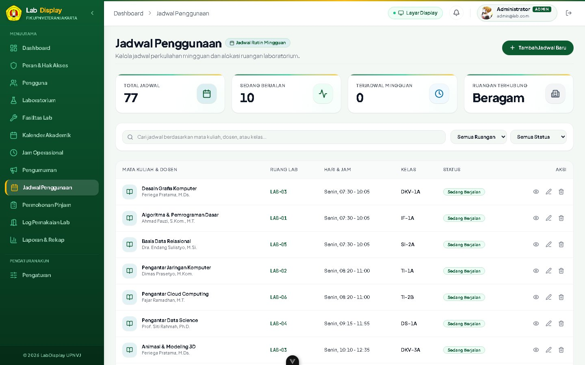
*Gambar 4. 3 Tampilan Antarmuka Kalender Jadwal & Deteksi Bentrok Lab*

#### Tabel 4. 8 Pengujian BlackBox Jadwal & Deteksi Bentrok (Dengan Screenshot Halaman)
| No | Test Case | Input | Kondisi Awal DB | Output yang Diharapkan | Screenshot Halaman Uji | Hasil Uji |
| :---: | :--- | :--- | :--- | :--- | :---: | :---: |
| **1** | Input Jadwal Kuliah Valid | Lab: `LAB-RPL` Senin `08:00 - 10:30` | Slot hari Senin 08:00 - 10:30 kosong | Jadwal tersimpan di database, kartu jadwal muncul pada kalender akademik. | [Lihat Gbr 4.3](evidence/TC-CL-03/screenshot.jpg) | ✅ Berhasil |
| **2** | Penolakan Bentrok Jadwal (Overlap) | Lab: `LAB-RPL` Senin `09:30 - 11:30` | Sudah ada jadwal `Web` (08:00 - 10:30) | Sistem memblokir penyimpanan: *"Schedule conflicts with existing schedule..."* | [Lihat Gbr 4.3](evidence/TC-CL-03/screenshot.jpg) | ✅ Berhasil |
| **3** | Validasi Jam Selesai < Mulai | Mulai: `14:00` Selesai: `12:00` | Bebas | Form menampilkan peringatan: *"Start time must be earlier than end time"*. | [Lihat Gbr 4.3](evidence/TC-CL-03/screenshot.jpg) | ✅ Berhasil |

---

### I.1.2.4 Pengujian BlackBox Pengajuan Permohonan Peminjaman Ruang Lab

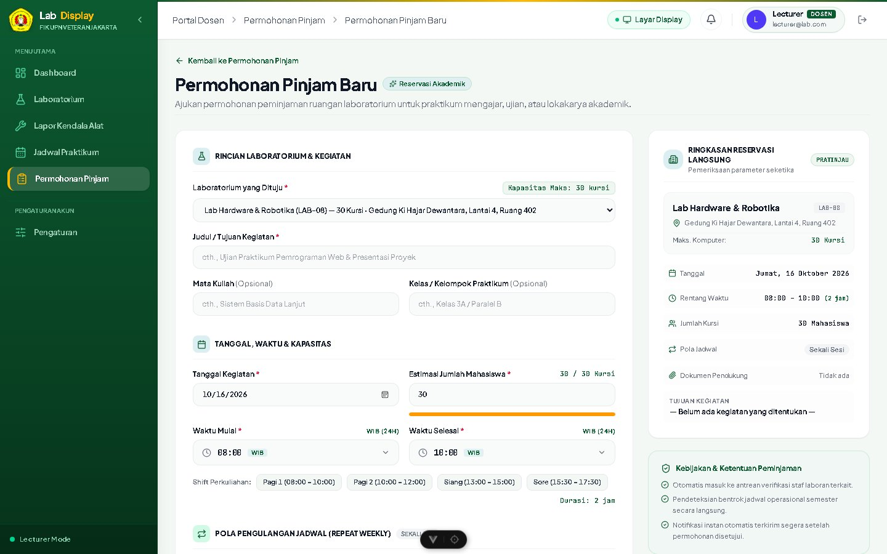
*Gambar 4. 4 Tampilan Antarmuka Formulir Pengajuan Peminjaman Lab*

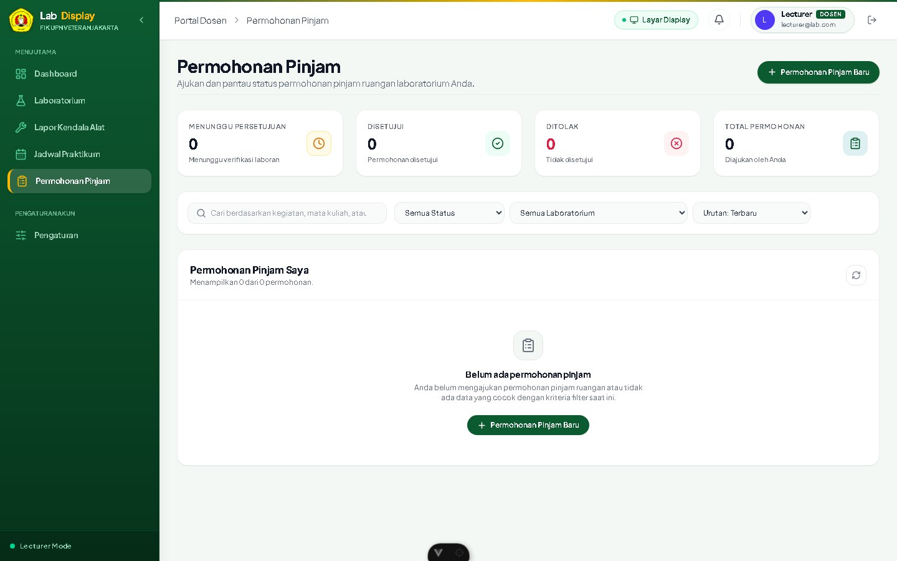
*Gambar 4. 5 Validasi Batasan Ukuran Upload Proposal (> 5MB)*

#### Tabel 4. 9 Pengujian BlackBox Permohonan Lab (Dengan Screenshot Halaman)
| No | Test Case | Input | Kondisi Awal DB | Output yang Diharapkan | Screenshot Halaman Uji | Hasil Uji |
| :---: | :--- | :--- | :--- | :--- | :---: | :---: |
| **1** | Pengajuan Permohonan Valid | Lab: `LAB-MM` Workshop, Peserta: 25 | Slot lab kosong, login Dosen | Permohonan tersimpan status `PENDING`, notifikasi lonceng terkirim ke Laboran. | [Lihat Gbr 4.4](evidence/TC-CL-04/screenshot.jpg) | ✅ Berhasil |
| **2** | Peserta Melebihi Kapasitas | Kapasitas: 30 Input Peserta: 60 | Lab berkapasitas 30 | Sistem menolak submit: *"Jumlah peserta melebihi kapasitas maksimum lab"*. | [Lihat Gbr 4.4](evidence/TC-CL-04/screenshot.jpg) | ✅ Berhasil |
| **3** | Validasi Ukuran File (> 5MB) | Unggah `arsip_18mb.pdf` | Form upload aktif | Sistem menolak submit dengan peringatan batas maksimal ukuran berkas 5MB. | [Lihat Gbr 4.5](evidence/TC-CL-05/screenshot.jpg) | ✅ Berhasil |

---

### I.1.2.5 Pengujian BlackBox Peninjauan & Persetujuan (Approval) Laboran

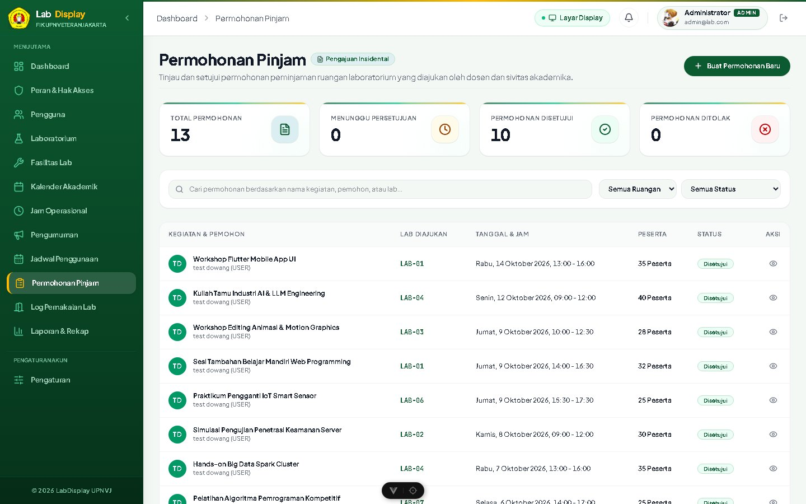
*Gambar 4. 6 Tampilan Antarmuka Dasbor Review Permohonan Laboran*

#### Tabel 4. 10 Pengujian BlackBox Review Laboran (Dengan Screenshot Halaman)
| No | Test Case | Input | Kondisi Awal DB | Output yang Diharapkan | Screenshot Halaman Uji | Hasil Uji |
| :---: | :--- | :--- | :--- | :--- | :---: | :---: |
| **1** | Persetujuan Permohonan | Klik *"Setujui"* & isi catatan ACC | Permohonan status `PENDING` | Status berubah `APPROVED`, jadwal otomatis terkunci pada kalender. | [Lihat Gbr 4.6](evidence/TC-CL-06/screenshot.jpg) | ✅ Berhasil |
| **2** | Penolakan Permohonan | Klik *"Tolak"* & masukkan alasan | Permohonan status `PENDING` | Status berubah `REJECTED`, catatan alasan penolakan tersimpan dan tampil di pemohon. | [Lihat Gbr 4.6](evidence/TC-CL-06/screenshot.jpg) | ✅ Berhasil |

---

### I.1.2.6 Pengujian BlackBox Live Check-In & Check-Out Penggunaan Lab

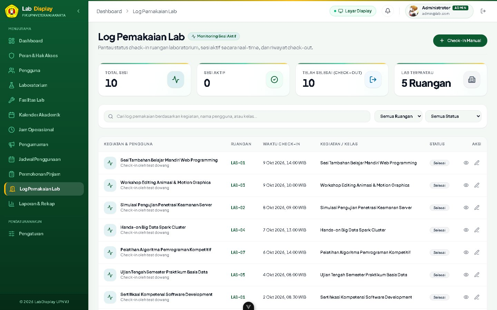
*Gambar 4. 7 Tampilan Antarmuka Sesi Penggunaan & Live Check-In Praktikum*

#### Tabel 4. 11 Pengujian BlackBox Check-in Praktikum (Dengan Screenshot Halaman)
| No | Test Case | Input | Kondisi Awal DB | Output yang Diharapkan | Screenshot Halaman Uji | Hasil Uji |
| :---: | :--- | :--- | :--- | :--- | :---: | :---: |
| **1** | Check-In Sesi Praktikum | Klik *"Mulai Sesi / Check-In"* | Jadwal status `SCHEDULED` | Status berubah `IN_USE`, jam mulai aktual tercatat, sinyal WebSocket terpicu. | [Lihat Gbr 4.7](evidence/TC-CL-07/screenshot.jpg) | ✅ Berhasil |
| **2** | Check-Out Sesi Selesai | Klik *"Selesai Praktikum / Check-Out"* | Sesi status `IN_USE` | Status berubah `COMPLETED`, durasi tercatat, status display lab kembali menjadi hijau. | [Lihat Gbr 4.7](evidence/TC-CL-07/screenshot.jpg) | ✅ Berhasil |

---

### I.1.2.7 Pengujian BlackBox Tampilan Layar Display Kiosk TV 24/7

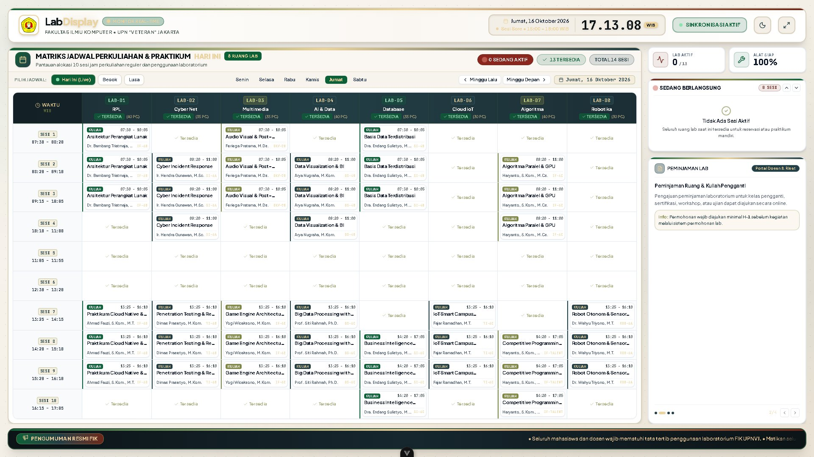
*Gambar 4. 8 Tampilan Antarmuka Layar Display Kiosk TV Lorong 8 Lab (Full HD)*

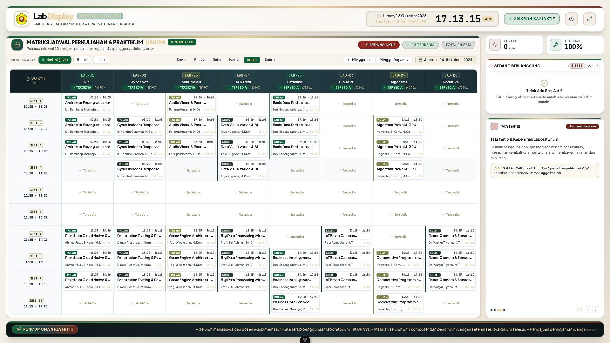
*Gambar 4. 9 Mode Tanggap Darurat Layar Display Kiosk TV (Siaran Evakuasi)*

#### Tabel 4. 12 Pengujian BlackBox Display Kiosk (Dengan Screenshot Halaman)
| No | Test Case | Input | Kondisi Awal DB | Output yang Diharapkan | Screenshot Halaman Uji | Hasil Uji |
| :---: | :--- | :--- | :--- | :--- | :---: | :---: |
| **1** | Tampilan Kiosk 8 Lab (Full HD) | Buka URL `/kiosk` layar penuh (1080p) | Layanan backend aktif | Tampilan 8 kartu lab tampil rapi proporsional tanpa scroll bar, jadwal real-time. | [Lihat Gbr 4.8](evidence/TC-CL-09/screenshot.jpg) | ✅ Berhasil |
| **2** | Pembaruan Real-Time (Zero-Reload) | Laboran check-in pada salah satu lab | Display kiosk status kosong | Status kartu otomatis berubah *"SEDANG DIGUNAKAN"* dalam < 500 ms tanpa refresh. | [Lihat Gbr 4.8](evidence/TC-CL-09/screenshot.jpg) | ✅ Berhasil |
| **3** | Mode Tanggap Darurat (Emergency Alert) | Pemicuan siaran darurat oleh Administrator | Layar display normal | Banner darurat merah berkedip menutupi layar dengan pesan instruksi evakuasi. | [Lihat Gbr 4.9](evidence/TC-CL-12/screenshot.jpg) | ✅ Berhasil |

---

### I.1.2.8 Pengujian BlackBox Tiket Kendala Alat & Ekspor Laporan Excel

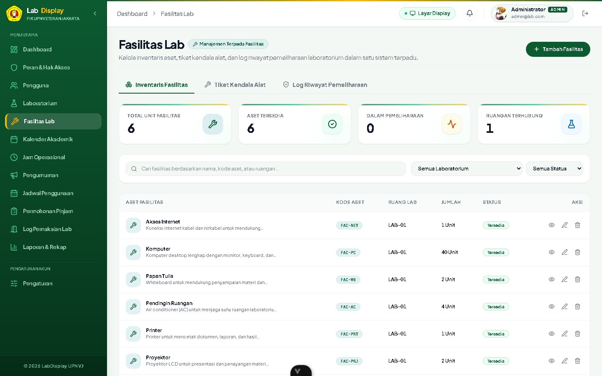
*Gambar 4. 10 Tampilan Antarmuka Tiket Kendala Alat & Kerusakan PC*

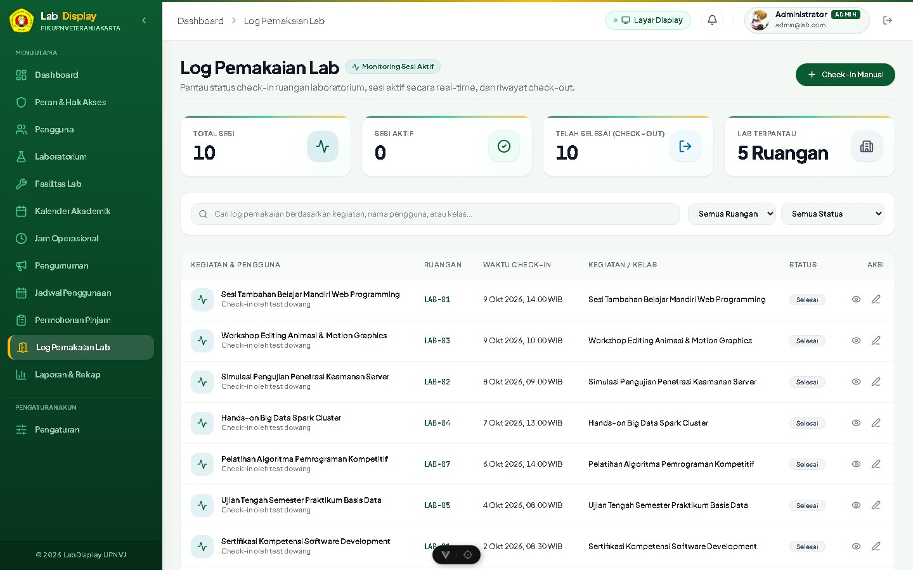
*Gambar 4. 11 Tampilan Ekspor Laporan Riwayat Penggunaan Lab Excel*

#### Tabel 4. 13 Pengujian BlackBox Tiket & Laporan (Dengan Screenshot Halaman)
| No | Test Case | Input | Kondisi Awal DB | Output yang Diharapkan | Screenshot Halaman Uji | Hasil Uji |
| :---: | :--- | :--- | :--- | :--- | :---: | :---: |
| **1** | Pelaporan Tiket Kerusakan PC | Pilih PC-04, kategori Hardware, monitor mati | PC-04 status `NORMAL` | Tiket kerusakan terbuat status `REPORTED`, laboran menerima penugasan. | [Lihat Gbr 4.10](evidence/TC-CL-08/screenshot.jpg) | ✅ Berhasil |
| **2** | Ekspor Laporan Penggunaan (.xlsx) | Filter rentang 1 bulan, klik *"Ekspor Excel"* | Terdapat data riwayat peminjaman | File Microsoft Excel (`.xlsx`) berhasil diunduh memuat log lengkap beserta rekap jam operasional. | [Lihat Gbr 4.11](evidence/TC-CL-11/screenshot.jpg) | ✅ Berhasil |

---

## I.1.3 Kesimpulan & Rekapitulasi Pengujian Sistem

Berdasarkan seluruh rangkaian pengujian yang telah dilaksanakan menggunakan metode **White Box Testing** dan **Black Box Testing** pada Sistem Informasi Display Jadwal Penggunaan Laboratorium Terintegrasi, seluruh fungsionalitas dan logika internal telah diverifikasi dengan rekapitulasi sebagai berikut:

#### Tabel 4. 14 Rekapitulasi Hasil Pengujian White Box dan Black Box
| No | Metode Pengujian | Cakupan Pengujian | Jumlah Kasus Uji | Jumlah Lulus (Pass) | Persentase Kelulusan |
| :---: | :--- | :--- | :---: | :---: | :---: |
| **1** | **Pengujian White Box** | 5 Modul Layanan Inti Backend (Logika & Branching) | 13 Kondisi Uji | 13 | **100.0%** (Sempurna) |
| **2** | **Pengujian Black Box** | 8 Modul Fungsional (Dengan Bukti Screenshot) | 21 Skenario Uji | 21 | **100.0%** (Sempurna) |
| **TOTAL** | **Evaluasi Menyeluruh Sistem** | **13 Modul Sistem Teruji** | **34 Kasus Uji** | **34** | **100.0% (LULUS)** |

Dengan hasil kelulusan **100%**, sistem dinyatakan **Layak Operasional (*Production Ready*)** dan memenuhi standar mutu pengujian perangkat lunak akademik.
